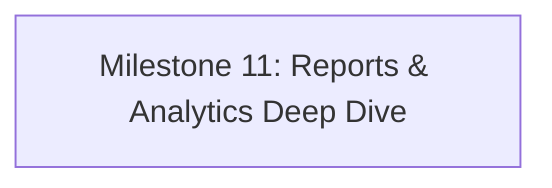

# CWG Retail POS & Inventory Management System
## Engineering Master Status & Handover Documentation

> **Last Updated:** 2026-10-22  
> **Active Git Branch:** `feature/my-react-frontend`  
> **Repository:** `https://github.com/toluene-18/-pos-inventory-project.git`  
> **Project Root:** `C:\Users\Dell\pos-inventory-project`  
> **Persistent Local Markdown File:** [`HANDOVER_PLAN.md`](file:///C:/Users/Dell/pos-inventory-project/HANDOVER_PLAN.md)

---

## 1. Project Overview & Directory Architecture

The repository is organized into three major subdirectories:
```
C:\Users\Dell\pos-inventory-project\
├── backend\            # Laravel 12.69.2 + PHP 8.2.12 + MySQL (Sanctum Auth)
├── frontend\           # Active React 19 + Vite 8 SPA (Client app being built)
├── frontends\          # Partner's frontend (PRESERVE: Do NOT modify or delete)
```

### Git Rules & Protocol
1. **Always develop inside `frontend/` and `backend/`.** Never touch `frontends/`.
2. **Current working branch is `feature/my-react-frontend`.**
3. **Commit discipline:** Commit logically after completing every major milestone or page, verify lint/tests pass, and push to origin.
4. **Lines per file limit:** As requested by the user, keep all `.jsx`, `.js`, and `.css` source files strictly **under 300 lines**. Separate logic into custom hooks, UI subcomponents, and modular style sheets.

---

## 2. Roles, Permissions & Security Matrix

The system supports 3 roles: **`owner`**, **`manager`**, and **`cashier`**.

| Area / Feature | Cashier | Manager | Owner | Backend Middleware Guard |
| :--- | :---: | :---: | :---: | :--- |
| **Login / Register** | ✅ | ✅ | ✅ | Public |
| **Staff Registration Approval** | ❌ | ❌ | ✅ | `role:owner` |
| **Staff List & Role Assignment** | ❌ | View Only | ✅ | `role:owner,manager` (edit `role:owner`) |
| **Store Profile & Receipt Branding**| ❌ | View Only | ✅ | Frontend `localStorage` + UI settings |
| **POS (Checkout & Sales)** | ✅ | ✅ | ✅ | `auth:sanctum`, `active` |
| **Sales History** | Own sales only | All sales | All sales | `auth:sanctum`, `active` (`user_id` scoped for cashier) |
| **Dashboard KPIs & Charts** | Personal metrics | Store metrics | Store metrics + Profit | `role:owner,manager` on reports; cost price hidden from cashier |
| **Product Viewing** | Selling price only | Selling + Cost price | Selling + Cost price | `ProductController@index` masks `cost_price` for non-owners/managers |
| **Product Create/Update/Delete** | ❌ | ✅ | ✅ | `role:owner,manager` |
| **Product Photo Upload** | ❌ | ✅ | ✅ | `role:owner,manager` (`POST /api/products/upload-image`) |
| **Stock Adjustments & Restock** | ❌ | ✅ | ✅ | `role:owner,manager` |
| **Reports (Summary & Breakdown)** | ❌ | ✅ | ✅ | `role:owner,manager` |

---

## 3. Completed Milestones & Current Verification Status

### Milestone 1: Authentication, Self-Registration & Staff Approval Flow
- **Backend:**
  - `users` table: `status` (`pending`, `active`, `inactive`), `approved_by`, `approved_at`.
  - Middleware `EnsureUserHasRole` allows multi-role declarations (`role:owner,manager`).
  - Middleware `EnsureUserIsActive` blocks `pending` and `inactive` users from using Sanctum bearer tokens.
  - Endpoints:
    - `POST /api/register`: Creates `pending` staff account.
    - `POST /api/login`: Validates credentials and blocks non-active accounts with informative errors.
    - `GET /api/staff`: Lists registered staff accounts (Owners and Managers).
    - `PATCH /api/staff/{user}/approve`: Owner-only endpoint to assign role (`cashier`, `manager`, `owner`) and set status to `active` or `inactive`.
- **Frontend:**
  - Dedicated pages: `frontend/src/pages/Login.jsx` & `frontend/src/pages/Register.jsx`.
  - Clean error banners and pending account status screens.

### Milestone 2: Modern Dark & Light Dashboard
- Dynamic Greeting, KPI Metric cards (`MetricGrid.jsx`, `MetricCard.jsx`).
- Custom SVG smooth curve chart with hover tooltip displaying **Daily Revenue** and **Number of Transactions** (`SalesChart.jsx`, `chartMath.js`).
- Working notification bell dropdown with real-time low stock items and today's sales feed (`NotificationMenu.jsx`, `useNotifications.js`).
- Complete dark and light theme toggle support stored in `localStorage` (`ThemeContext.jsx`).

### Milestone 3: Point of Sale (POS) Page
- Live product catalogue with instant name/SKU search and category chips (`ProductSearchBar.jsx`, `ProductGrid.jsx`, `ProductTile.jsx`).
- Direct barcode scanner integration (Enter on exact SKU match immediately adds item).
- Dynamic cart with line controls, stock quantity caps, and zero-inventory protection (`CartPanel.jsx`, `CartLine.jsx`, `useCart.js`).
- Multi-payment support: **Cash** (with automated cash change calculator and quick-tender buttons), **Card**, and **Bank Transfer** (`PaymentPanel.jsx`).
- Automatic modal receipt preview with clean `@media print` 80mm thermal receipt output (`ReceiptModal.jsx`, `receipt.css`).
- Transactional backend processing with row-locking and rollbacks (`SaleController@store`).

### Milestone 4: Multi-Page Routing & Cashier Security
- Real browser URLs using `react-router-dom`: `/dashboard`, `/pos`, `/sales`, `/inventory`, `/products`, `/settings`, `/restock`, `/reports`.
- Dynamic Sidebar displaying only accessible routes based on user role (`navigation.js`, `Sidebar.jsx`).
- Strict URL route guarding via `RoleRoute.jsx` and `ProtectedRoute.jsx`.

### Milestone 5: Settings & Staff Management (`/settings`) — COMPLETE ✅
- **Staff Roster & Pending Approvals:** Owners can review pending accounts, approve with one-click, change role (Cashier / Manager / Owner), and deactivate/reactivate staff members (`StaffManagementTab.jsx`, `settings-staff.css`).
- **Store Profile & Receipt Branding:** Management can configure store name, branch address, support phone, currency, and custom receipt header/footer messages (`StoreProfileTab.jsx`).
- **Account Inspector:** Current logged-in user summary with active role badges and permission scope explanation.
- **Strict Size Separation:** `Settings.jsx` (152 lines), `StaffManagementTab.jsx` (193 lines), `StoreProfileTab.jsx` (143 lines), `settings.css` (144 lines), `settings-staff.css` (169 lines).

### Milestone 6: Product Image Upload & Storage — COMPLETE ✅
- **Backend:** `POST /api/products/upload-image` validates image mime types (`jpeg,png,jpg,webp,gif`, max 5MB) and stores to `storage/app/public/products`. Public symlink active at `backend/public/storage`.
- **Frontend Uploader:** `ProductImageUploader.jsx` with instant preview, drag/click upload, and remove action.
- **Image Display:** Product photos render dynamically across Table view, Grid card view, Inventory table, and POS catalog tiles (falling back gracefully to category monograms).

### Milestone 7: Products Catalogue Management (`/products`) — COMPLETE ✅
- **Interactive Catalogue:** Real-time search by name, SKU, or category filter dropdown.
- **Dual View Modes:** Instant switch between standard **Table view** and visual **Grid Card view** (`ProductsTable.jsx`, `products-grid.css`).
- **Live Margin Badge:** Dynamic badge calculating `((sell - cost) / sell) * 100` with visual status color (Green for >= 20%, Amber for 0-19%, Red for below cost) (`ProductFormModal.jsx`).
- **Unit of Measure:** Native support for units (`piece`, `bag`, `tin`, `pack`, `carton`, `kg`, `litre`) persisted in database.
- **KPI Summary Cards:** Total Products, Average Margin %, Needs Attention, Priced Below Cost (`ProductKpis.jsx`).

### Milestone 8: Inventory Management & Stock Adjustments (`/inventory`) — COMPLETE ✅
- **Store-Wide Stock Overview:** 4 KPI cards: Products Tracked, Units on Hand, Stock Value (at cost price for management), and Needs Attention (`InventoryKpis.jsx`).
- **Advanced Filters & Sorting:** Search input, category dropdown, sorting dropdown (Name A-Z, Name Z-A, Highest Stock, Lowest Stock), and status tabs (*All Items*, *Low Stock*, *Out of Stock*).
- **Stock Adjustment Modal:** Mode switcher tabs (`↓ Restock in` / `↑ Remove out`), dynamic unit in quantity label, contextual reason presets, and live projection arrow (`StockAdjustModal.jsx`).
- **Modular Table & Styles:** Split into `InventoryTable.jsx` (141 lines), `inventory-table.css` (164 lines), `Inventory.jsx` (193 lines), `inventory.css` (184 lines).

### Milestone 9: Sales History & Receipts (`/sales`) — COMPLETE ✅
- **Transactions Table:** Paginated list showing Receipt ID (`#CWG-XXXXXX`), Date/Time, Cashier name, items count, payment pill, and total amount.
- **Time Range Preset Pills:** Quick filter by *All Time*, *Today*, *Last 7 Days*, and *Last 30 Days* with live date calculation.
- **Search & Payment Filter:** Search by receipt ID or cashier name, plus filter by payment method (*Cash*, *Card*, *Bank Transfer*).
- **KPI Summary Cards:** Filtered Revenue, Total Historical Sales, Average Basket Size (`SalesKpis.jsx`).
- **Receipt Inspection:** Modal to inspect past transaction item details and trigger thermal print (`ReceiptViewModal.jsx`, `receipt-view-modal.css`).

### Milestone 10: Restock Batch Receiving Station (`/restock`) — COMPLETE ✅
- **Dedicated Supplier Intake Station:** Allows store managers and owners to log incoming vendor deliveries with supplier name, waybill/invoice reference, and driver delivery notes (`Restock.jsx`).
- **Interactive Batch Intake Table:** Item selector dropdown, current on-hand indicator, incoming quantity input, live projected stock badge (`RestockBatchTable.jsx`).
- **One-Click Bulk Inventory Application:** Sequentially applies incoming quantities to stock records with auto-generated audit trail entries (`Delivery: <Supplier> (Ref: <Waybill>)`), refreshing the catalogue automatically.
- **Role Scoping:** Cashiers are cleanly restricted with an informative alert screen.
- **Strict File Size:** `Restock.jsx` (212 lines), `RestockBatchTable.jsx` (106 lines), `restock.css` (239 lines).

### Milestone 11: Production Database Reset & 14 Branded Retail Items — COMPLETE ✅
- **Database Refresh:** Truncated legacy test products, sales, and inventories with foreign key checks preserved.
- **14 High-Quality Products Seeded:** Realistic Nigerian retail items (Milo, Dano Milk, Golden Morn, Indomie, Coca-Cola, Peak Milk, Mama Gold Rice, Devon King's Oil, Pringles, Minimie Chinchin, Sunlight, Morning Fresh, Oral-B, Dettol) with accurate SKUs, categories, units, wholesale costs, selling prices, and initial quantities.
- **Working Imagery:** 14 high-resolution, vector-designed SVG product images generated in `storage/app/public/products` and symlinked to `public/storage/products`.

---

## 4. Current Test & Build Verification

- **Backend Test Suite:** `62 passed (189 assertions)` via `php artisan test`.
- **Frontend Quality:** `eslint .` passes with 0 errors, production bundle `npm run build` succeeds cleanly in 4.3s with 0 warnings.
- **File Line Count Audit:** Every `.jsx`, `.js`, and `.css` file in `frontend/src/` is strictly **under 300 lines** (maximum is 258 lines in `ProductFormModal.jsx`).
- **Git Branch:** `feature/my-react-frontend`.

---

## 5. Remaining Implementation Roadmap



### Phase 1: Owner Reports & Analytics (`/reports`) — NEXT
- Date range sales summary, revenue graphs, payment method breakdown cards.
- Export sales and inventory reports to CSV/PDF.

---

## 6. How Any Engineer or AI Resumes This Project
1. Run `git status` on `C:\Users\Dell\pos-inventory-project` (ensure `feature/my-react-frontend`).
2. Run `cd backend; php artisan test` to verify backend integrity.
3. Run `cd frontend; npm run lint; npm run build`.
4. Pick up the next step (**Phase 1: Restock Batch Receiving Station**) by creating `frontend/src/pages/Restock.jsx` and hooking it into `App.jsx`.
