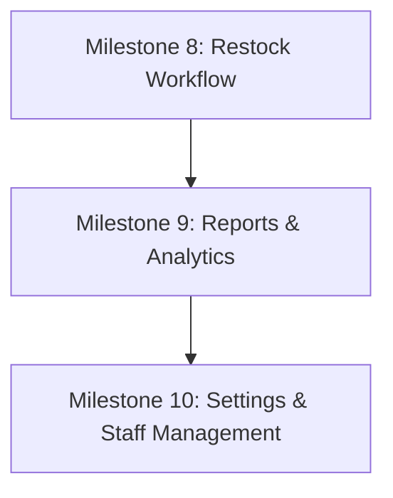

# CWG Retail POS & Inventory Management System
## Engineering Master Status & Handover Documentation

> **Last Updated:** 2026-10-22  
> **Active Git Branch:** `feature/my-react-frontend`  
> **Repository:** `https://github.com/toluene-18/-pos-inventory-project.git`  
> **Project Root:** `C:\Users\Dell\pos-inventory-project`  
> **Persistent Local Markdown File:** [`HANDOVER_PLAN.md`](file:///C:/Users/Dell/pos-inventory-project/HANDOVER_PLAN.md)

---

## 1. Project Overview & Directory Architecture

The repository is organized into three major subdirectories:
```
C:\Users\Dell\pos-inventory-project\
├── backend\            # Laravel 12.69.2 + PHP 8.2.12 + MySQL (Sanctum Auth)
├── frontend\           # Active React 19 + Vite 8 SPA (Client app being built)
├── frontends\          # Partner's frontend (PRESERVE: Do NOT modify or delete)
```

### Git Rules & Protocol
1. **Always develop inside `frontend/` and `backend/`.** Never touch `frontends/`.
2. **Current working branch is `feature/my-react-frontend`.**
3. **Commit discipline:** Commit logically after completing every major milestone or page, verify lint/tests pass, and push to origin.
4. **Lines per file limit:** As requested by the user, keep all `.jsx`, `.js`, and `.css` source files strictly **under 300 lines**. Separate logic into custom hooks, UI subcomponents, and modular style sheets.

---

## 2. Roles, Permissions & Security Matrix

The system supports 3 roles: **`owner`**, **`manager`**, and **`cashier`**.

| Area / Feature | Cashier | Manager | Owner | Backend Middleware Guard |
| :--- | :---: | :---: | :---: | :--- |
| **Login / Register** | ✅ | ✅ | ✅ | Public |
| **Staff Registration Approval** | ❌ | ❌ | ✅ | `role:owner` |
| **Staff List / Deactivation** | ❌ | ❌ | ✅ | `role:owner` |
| **POS (Checkout & Sales)** | ✅ | ✅ | ✅ | `auth:sanctum`, `active` |
| **Sales History** | Own sales only | All sales | All sales | `auth:sanctum`, `active` (`user_id` scoped for cashier) |
| **Dashboard KPIs & Charts** | Personal metrics | Store metrics | Store metrics + Profit | `role:owner,manager` on reports; cost price hidden from cashier |
| **Product Viewing** | Selling price only | Selling + Cost price | Selling + Cost price | `ProductController@index` masks `cost_price` for non-owners/managers |
| **Product Create/Update/Delete** | ❌ | ✅ | ✅ | `role:owner,manager` |
| **Stock Adjustments & Restock** | ❌ | ✅ | ✅ | `role:owner,manager` |
| **Reports (Summary & Breakdown)** | ❌ | ✅ | ✅ | `role:owner,manager` |

---

## 3. Completed Milestones & Current Verification Status

### Milestone 1: Authentication, Self-Registration & Staff Approval Flow
- **Backend:**
  - `users` table migration: added `status` (`pending`, `active`, `inactive`), `approved_by`, `approved_at`.
  - Middleware `EnsureUserHasRole` allows multi-role declarations (`role:owner,manager`).
  - Middleware `EnsureUserIsActive` blocks `pending` and `inactive` users from using Sanctum bearer tokens.
  - Endpoints:
    - `POST /api/register`: Creates `pending` staff account.
    - `POST /api/login`: Validates credentials and blocks non-active accounts with informative errors.
    - `PATCH /api/staff/{user}/approve`: Owner-only endpoint to assign role (`cashier`, `manager`, `owner`) and set status to `active` or `rejected`.
- **Frontend:**
  - Dedicated pages: `frontend/src/pages/Login.jsx` & `frontend/src/pages/Register.jsx`.
  - Clean error banners and pending account status screens.

### Milestone 2: Modern Dark & Light Dashboard (Matches Design)
- Dynamic Greeting, KPI Metric cards (`MetricGrid.jsx`, `MetricCard.jsx`).
- Custom SVG smooth curve chart with hover tooltip displaying **Daily Revenue** and **Number of Transactions** (`SalesChart.jsx`, `chartMath.js`).
- Working notification bell dropdown with real-time low stock items and today's sales feed (`NotificationMenu.jsx`, `useNotifications.js`).
- Complete dark and light theme toggle support stored in `localStorage` (`ThemeContext.jsx`).

### Milestone 3: Point of Sale (POS) Page
- Live product catalogue with instant name/SKU search and category chips (`ProductSearchBar.jsx`, `ProductGrid.jsx`, `ProductTile.jsx`).
- Direct barcode scanner integration (Enter on exact SKU match immediately adds item).
- Dynamic cart with line controls, stock quantity caps, and zero-inventory protection (`CartPanel.jsx`, `CartLine.jsx`, `useCart.js`).
- Multi-payment support: **Cash** (with automated cash change calculator and quick-tender buttons), **Card**, and **Bank Transfer** (`PaymentPanel.jsx`).
- Automatic modal receipt preview with clean `@media print` 80mm thermal receipt output (`ReceiptModal.jsx`, `receipt.css`).
- Transactional backend processing with row-locking and rollbacks (`SaleController@store`).

### Milestone 4: Multi-Page Routing & Cashier Security
- Real browser URLs using `react-router-dom`: `/dashboard`, `/pos`, `/sales`, `/inventory`, `/products`, `/restock`, `/reports`, `/settings`.
- Dynamic Sidebar displaying only accessible routes based on user role (`navigation.js`, `Sidebar.jsx`).
- Strict URL route guarding via `RoleRoute.jsx` and `ProtectedRoute.jsx`.

### Milestone 5: Products Catalogue Management (`/products`) — COMPLETE ✅
- **Interactive Catalogue:** Real-time search by name, SKU, or category filter pills.
- **Role-Gated Columns:** Selling price visible to all; cost price visible exclusively to Owners and Managers.
- **Product Modal Form:** Add new products or edit existing records (`ProductFormModal.jsx`), including SKU uniqueness, prices, category, initial stock, and threshold alerts.
- **Soft Deactivation:** Safe deactivation preserves transaction records while hiding item from POS.
- **Styling & Size:** Kept under 300 lines per file (`Products.jsx`, `ProductFormModal.jsx`, `products.css`, `products-modal.css`).

### Milestone 6: Inventory Management & Stock Adjustments (`/inventory`) — COMPLETE ✅
- **Store-Wide Stock Overview:** Real-time KPI summary (Total units in store, Low stock warnings, Out of stock count).
- **Tab Filters:** Filter between *All Stock*, *Low Stock*, and *Out of Stock*.
- **Stock Adjustment Modal:** Owners & Managers can add (+) or deduct (−) stock with live on-hand preview (`StockAdjustModal.jsx`).
- **Audit Trails & Reason Tracking:** Presets and custom text fields for shipments, damaged items, expired products, cycle counts, or loss prevention.
- **Zero-Floor Protection:** Frontend and backend row-locked guards prevent negative inventory levels.
- **Modular Services:** Storage separated into `authStorage.js`, keeping `api.js` clean at 171 lines.

### Milestone 7: Sales History & Receipts (`/sales`) — COMPLETE ✅
- **Transactions Table:** Paginated list of completed sales showing Receipt ID, Timestamp, Cashier name (Owners & Managers), items count, payment method pill, and total.
- **Strict Role Scoping:** Cashiers see strictly their own processed sales; Owners and Managers see all store-wide sales.
- **Multi-Filter Bar:** Filter by Payment Method (*Cash*, *Card*, *Bank Transfer*), Date From, and Date To with instant reset option.
- **Receipt Modal & Reprinting:** View past transactions and reprint thermal receipts (`ReceiptViewModal.jsx`).
- **File Size Discipline:** `Sales.jsx` (254 lines), `ReceiptViewModal.jsx` (104 lines), `sales.css` (272 lines).

---

## 4. Current Test & Build Verification

- **Backend Test Suite:** `62 passed (189 assertions)` via `php artisan test`.
- **Frontend Quality:** `eslint .` passes with 0 errors, production bundle `npm run build` succeeds cleanly in < 1s.
- **File Line Count Audit:** Every `.jsx`, `.js`, and `.css` file in `frontend/src/` is strictly **under 300 lines**.
- **Git Branch:** `feature/my-react-frontend` is completely clean and pushed to `origin`.

---

## 5. Remaining Implementation Roadmap



### Phase 1: Restock Workflow (`/restock`) — NEXT
- **Backend Available:** `POST /api/products/{product}/stock-adjustments`.
- **Frontend To Build:**
  1. `frontend/src/pages/Restock.jsx`: Dedicated intake station for receiving incoming inventory shipments.
  2. Quick item picker, intake batch table with incoming quantity inputs, supplier / batch note, and one-click bulk stock intake confirmation.
  3. Styles: `frontend/src/styles/restock.css` (< 300 lines).

### Phase 2: Owner Reports (`/reports`)
- Date range sales summary, revenue graphs, payment method breakdown cards.

### Phase 3: Settings & Staff Approval Management (`/settings`)
- List pending staff sign-ups, approve/reject buttons, role assignment modal, and deactivate staff button.

---

## 6. How Any Engineer or AI Resumes This Project
1. Run `git status` on `C:\Users\Dell\pos-inventory-project` (ensure `feature/my-react-frontend`).
2. Run `php artisan test` in `backend/` to verify backend integrity.
3. Run `npm run lint` and `npm run build` in `frontend/`.
4. Pick up the next step (**Phase 1: Restock Workflow**) by creating `frontend/src/pages/Restock.jsx` and hooking it into `App.jsx`.
